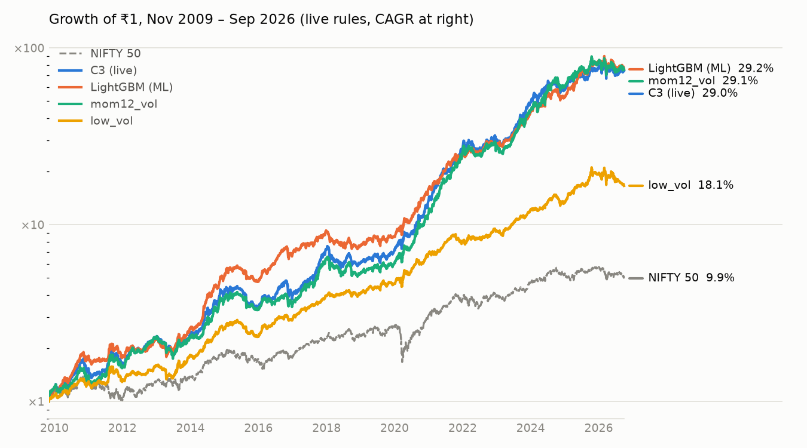
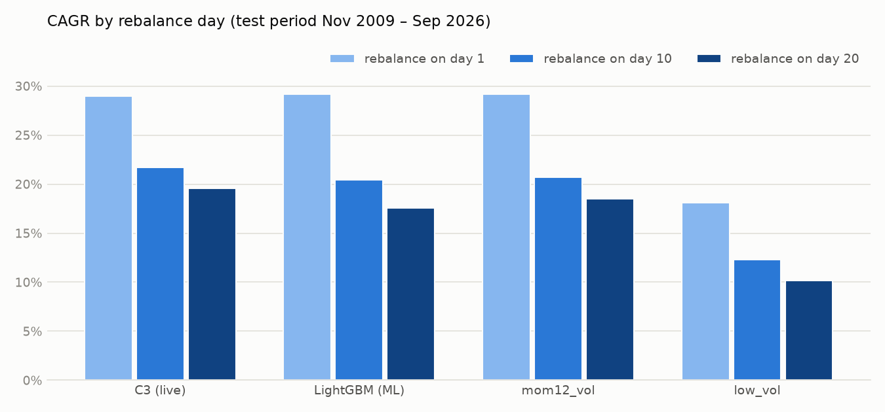

# Human vs Machine: Stock Selection on NIFTY 500

**Question:** can a machine-learning model pick NIFTY 500 stocks better than
human-designed rules, when both trade under identical, realistic rules?

**Answer:** no. On 17 years of out-of-sample data (Nov 2009 – Sep 2026), my
live rule-based strategy **C3** and a **LightGBM** model are statistically tied
at about **29% CAGR**. ML ranks stocks more accurately and has a smoother ride,
but it trades ~50% more. C3 is simpler, cheaper to trade and the most robust to
timing, so it stays my live strategy.

<picture>
  <source media="(prefers-color-scheme: dark)" srcset="docs/equity_dark.png">
  
</picture>

## Results (test period Nov 2009 – Sep 2026, live rules)

| Strategy | Type | CAGR | Worst fall | Sharpe | Trades/yr | Rank IC |
|---|---|---|---|---|---|---|
| LightGBM | ML | **29.2%** | −22.5% | **1.68** | 13.4× | **0.10** |
| mom12_vol | Human | 29.1% | −25.2% | 1.46 | 8.6× | 0.06 |
| **C3 (live)** | Human | 29.0% | −24.6% | 1.44 | 8.7× | 0.06 |
| low_vol | Human | 18.1% | −21.4% | 1.37 | 7.8× | 0.06 |
| NIFTY 50 buy & hold | – | 9.9% | −38.4% | 0.67 | – | – |

- **Bootstrap** (10,000 block resamples): LightGBM vs C3 +0.6pp, p = 0.44;
  mom12_vol vs C3 +0.3pp, p = 0.45 → **tied**. low_vol −10.8pp, p = 0.995 →
  **significantly worse**, so the test can tell good ideas from weak ones.
- **Monte Carlo** (1,000 random 3–15 year windows): mean CAGR mom12_vol 31.1%,
  C3 30.8%, LightGBM 29.4%, low_vol 19.6%.
- **Different paths, same destination:** C3 and LightGBM each won 9 of 18
  calendar years, with yearly gaps up to 48pp (`outputs/real/strategy_yearly.csv`).
- **Context:** over 24 years (Nov 2002 – Sep 2026) C3 made 36.1% CAGR. ML can't
  be tested there: it needs 2002–2009 to train.

### Rebalance-day check

| Strategy | Day 1 | Day 10 | Day 20 | Average |
|---|---|---|---|---|
| **C3** | 29.0% | **21.7%** | **19.6%** | **23.4%** |
| mom12_vol | 29.1% | 20.7% | 18.5% | 22.8% |
| LightGBM | 29.2% | 20.5% | 17.6% | 22.4% |
| low_vol | 18.1% | 12.3% | 10.1% | 13.5% |

Every strategy loses 8–12pp when trading on the 10th or 20th instead of the 1st,
so the timing effect belongs to monthly momentum in India, not to one formula.
C3 is the most robust of the top three. Quote ~23% as the conservative figure.

<picture>
  <source media="(prefers-color-scheme: dark)" srcset="docs/rebalance_days_dark.png">
  
</picture>

## The strategies

| Name | Score (higher = buy) | Idea |
|---|---|---|
| **C3** | (12-1m + 6m + 3m return) / 3 ÷ 126-day volatility | Steady climbers over three timeframes (my live strategy) |
| mom12_vol | 12m return ÷ 126-day volatility | Simpler C3: one lookback instead of three |
| low_vol | − 126-day volatility | Defensive: the calmest stocks |
| LightGBM | learned from 18 features | Let the model combine all signals |

`tests/test_strategies.py` checks that C3 here equals the live code's formula
to 1e-9.

## Trading rules (identical for every strategy)

1. Decide at the **last trading day's close**, trade at the **next open** (1st trading day).
2. **Gate:** hold stocks if NIFTY 50 > SMA100 **or** ≥ 60% of NIFTY 500 members
   are above their SMA200; otherwise sell everything and hold **GOLDBEES**.
3. Hold the **top 20**: sell anything ranked below 20, buy new entrants with the
   freed cash split equally, never trim winners.
4. Costs **0.20% buy / 0.30% sell** (gold 0.05%). Universe: members with ≥ 1 year of history.

## Data

- Daily NSE prices for 4,500 stocks, 2000–2026, **including delisted stocks**,
  total-return adjusted (splits, bonuses, dividends).
- **Point-in-time NIFTY 500 membership.** Historical lists are snapshots with
  gaps of up to 4 years (2006–2016); `build_membership.py` fills them with the
  logged index changes and drops stocks after their last trade: **96–97%** match
  with the list at each gap's end vs 78–82% for carrying the old list forward.
- Prices ≤ 0 (old bhavcopy rows) become missing on load (`tests/test_data.py`).

## The ML model

- **Rows:** one per (month, stock), ~143,000. **Features (18):** momentum
  (1/3/6/12/12-1m), volatility, downside volatility, drawdown, distance to the
  52-week high / SMA50 / SMA200, volume trend, turnover, plus 4 market-state
  features. Stock features are z-scored within each month.
- **Label:** next month's return rank within the month (open to next open).
- **Walk-forward:** train on 2002 → year N, predict year N+1, retrain yearly,
  1-month embargo. The model never sees the year it predicts.
- **No lookahead:** `tests/test_leakage.py` perturbs every price from T onward
  and asserts the features for T don't change.
- **What it learned (SHAP):** 12-1 momentum, distance from SMA50 and volatility
  matter most, the same ingredients as C3, combined differently by market state.
- Ridge regression, a histogram decision tree and gradient boosting are also
  implemented **from scratch in NumPy** and tested against sklearn
  (`mlrank/models/`); the scratch GBM reaches 28.3% CAGR vs LightGBM's 29.2%.

## Live output

```bash
make live        # gate status + this month's C3 top 20 (+ watchlist)
```
On the 30 Sep 2026 close: **gate off → GOLDBEES** (NIFTY 50 below SMA100,
breadth 42%).

## gRPC service

`service/strategy.proto` defines three calls; `make serve` starts the server.

| RPC | Returns |
|---|---|
| `GetGate` | stocks or gold at the latest close |
| `GetRanking(strategy, top_n)` | top N for c3 / mom12_vol / low_vol / lgbm_reg (ML trained on first use, cached) |
| `RunBacktest(strategy, start, end)` | **server stream:** month-by-month equity, then CAGR / drawdown / Sharpe / turnover |

```bash
python service/client.py gate
python service/client.py ranking --strategy c3 --top 20
python service/client.py backtest --strategy lgbm_reg --start 2009-11-01
```
The server and `scripts/live_ranking.py` share `mlrank/live.py`, so they always agree.

## Run

```bash
pip install -r requirements.txt
make synthetic && make test          # pipeline check on fake data (23 tests)
make all FLAG=                       # real data: panel -> ML -> comparison -> SHAP
make days                            # rebalance-day check
python scripts/compare_days.py && python scripts/make_charts.py
```
Real data goes in `data/` (see `data/README.md`); outputs land in `outputs/real/`.

## Layout

```
mlrank/
  config.py         every parameter (rules, costs, splits)
  data_loader.py    files -> MarketData, cleaning, rebalance dates
  features.py       point-in-time features
  dataset.py        labels + panel
  splits.py         walk-forward splits with embargo
  strategies.py     the human strategies (C3, mom12_vol, low_vol)
  models/           LightGBM + from-scratch ridge / tree / GBM
  experiment.py     walk-forward ML predictions
  backtest.py       live-rule portfolio simulation + gate
  bootstrap.py      block bootstrap of CAGR differences
  explain.py        SHAP / permutation importance
  live.py           latest-close ranking (script + gRPC)
scripts/            one entry point per step
service/            gRPC proto, server, client
tests/              leakage, data, splits, models, backtest, strategies, service
```

## Limitations

- **C3 was designed on this market's history** (a large rule search), so its
  24-year number is optimistic; the 2009–2026 comparison with ML is the fair one.
- **Rebalance timing matters:** ~29% on the 1st vs ~23% averaged over days.
- **One market, price and volume only:** no fundamentals; the same C3 rules
  lost to plain momentum on five other markets in an earlier study.
- **Membership in 2006–2016 is reconstructed** (~96–97% accurate).
- Taxes are not modelled here; higher turnover (ML) would pay more short-term gains tax.
